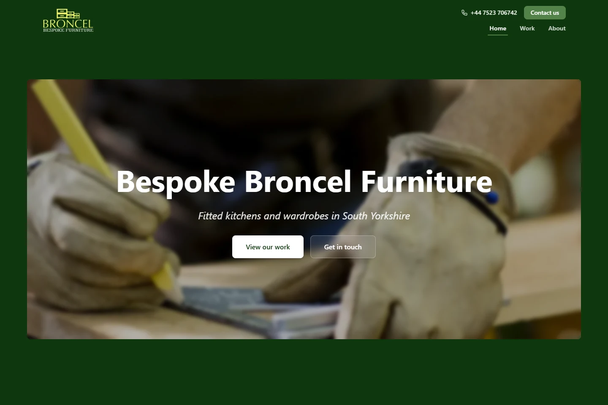
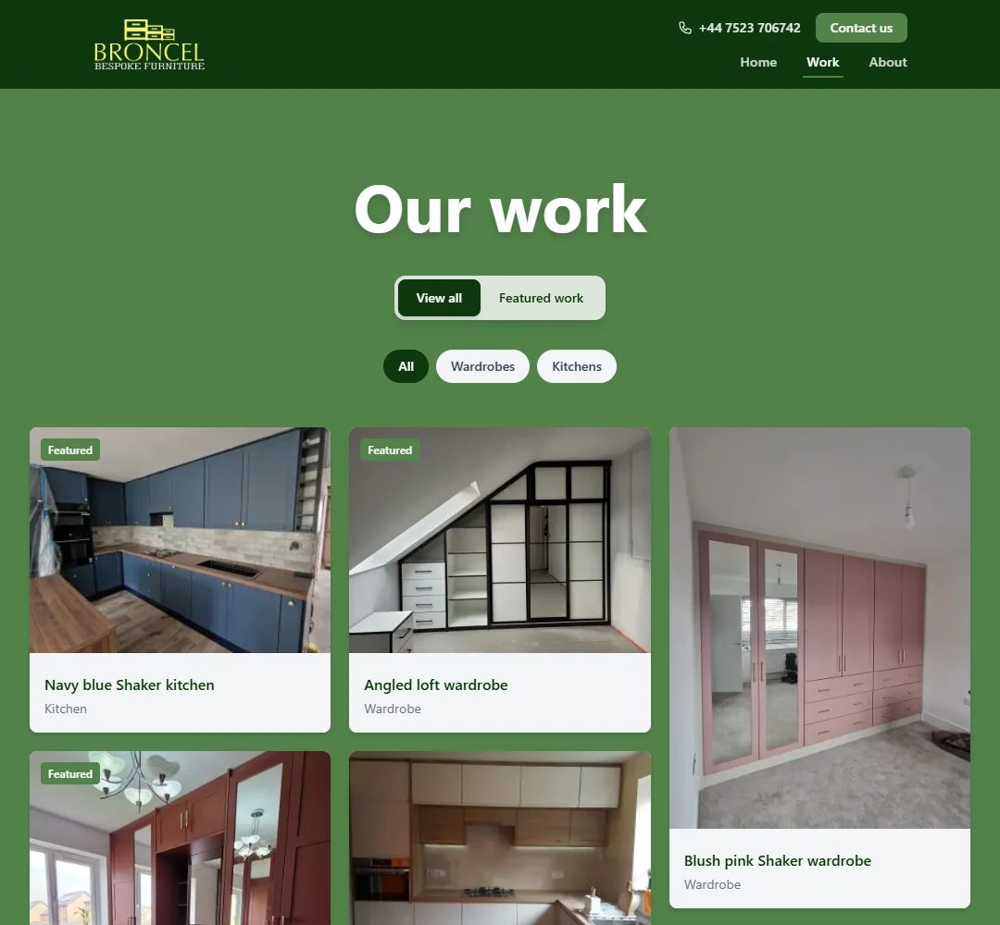
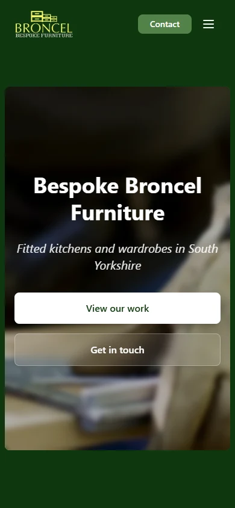

# Bespoke Broncel Furniture

A website for Bespoke Broncel Furniture, a fitted furniture business in South Yorkshire.

Visit [broncelfurniture.com](https://www.broncelfurniture.com).

## Screenshots



<table>
    <tr>
        <th>Project gallery</th>
        <th>Mobile home page</th>
    </tr>
    <tr>
        <td width="72%"></td>
        <td width="28%"></td>
    </tr>
</table>

## What it does

- Visitors can filter kitchen and wardrobe projects and open a separate page for each project.
- The contact form validates enquiries in the browser and on the server. It checks for spam, limits submissions and sends emails through Resend.
- PostHog records page visits and portfolio interactions when analytics are enabled.
- Pages include search metadata, social sharing images and structured business information.
- Layouts adapt to screen size. Animations respect reduced-motion settings.

## Technology

- Next.js 16.4 and React 19.3 render the site.
- Bun 1.4.3 installs dependencies, runs scripts, checks types and runs tests.
- Tailwind CSS 4.3 supplies styles. CSS animates scroll-linked photographs, the hero entrance and gallery transitions. Reduced-motion settings keep photographs still and disable entrance animations.
- Resend sends contact emails. PostHog provides optional analytics.
- Turso stores the shared contact form rate limit.
- ESLint checks code, and Prettier formats it.

Edit portfolio content in `lib/data/past-work.ts` and business details in `lib/data/contact.ts`.

The hero serves its original 1743×1001 WebP, about 54 KB, to avoid another lossy resize. A static import gives it a versioned URL for long-term caching. Other photographs use responsive image variants. Parallax moves each photograph behind its container while text stays anchored to that container, without scrolling zoom. The movement uses the existing crop while the container passes through view. CSS scroll timelines position the photograph from the first render, so hydration does not reposition it. Photo frames use `overflow-clip` so timelines follow the page rather than a nested scroll container. Browsers without scroll-timeline support show static photographs.

## Local development

Install Bun 1.4.3 and Node.js 24.x. `.bun-version` and `packageManager` pin Bun. `bun.lock` records dependency versions. Next.js uses Node for some workers. `.node-version` pins the Node version for local tools and deployment hosts.

```bash
bun install --frozen-lockfile
cp .env.example .env.local
bun run dev
```

Open [http://localhost:3000](http://localhost:3000).

Set the site URL, analytics options and email settings in `.env.local`. `.env.example` explains each setting. To send contact emails, provide a Resend API key and the sender and recipient addresses. Keep credentials out of Git.

## Quality checks

```bash
bun run check            # Run lint, type checks and unit tests in parallel.
bun run format:check
bun run build
bun run start            # Serve the production build with Bun.
bun run test:integration # Build first. The tests use a local email server.
bun run test:seo         # Check metadata, page structure and project links in the production build.
bun run test:browser     # Build first. Requires Google Chrome. Check loading and parallax in a browser.
bun run test:dev         # Check development pages and generated CSS.
bun run test:watch       # Rerun unit tests when files change.
bun run test:coverage    # Print coverage and write coverage/lcov.info.
```

Tests use `bun:test`. Bun mocks the clock, checks image files and runs the integration servers. `bun test` finds unit tests under `tests/`. Run the three `*.integration.ts` suites through their named scripts. Each suite stops its servers when it finishes. Contact tests use a local email server and do not send emails through Resend.

The development test starts its own server. If a dev server is already running, set `TEST_DEV_URL` to its URL to test it without starting or stopping another server.

`bun run test:browser` checks the background before and after delayed hydration, photograph movement within its container, anchored text, image resolution and reduced motion on desktop and mobile layouts. It uses the installed Google Chrome through Playwright Core and starts its own production server.

`bun run typecheck` generates Next.js route types, then runs Bun's built-in TypeScript 7 checker with `bun --check`. Links use typed routes, and project pages use the generated `PageProps` type. Next.js also checks types during the production build.

Git checks out text files with LF line endings so Prettier checks behave the same on Windows and Unix.

The full TypeScript 6 SDK remains installed for Next.js, ESLint and editor language servers, including Zed. Its JavaScript and DOM declarations let editors resolve standard types such as `Date` and `HTMLInputElement`.

Both `bun audit` and `bun audit --production` report no vulnerabilities. A pinned override replaces the Next.js lint plugin's `fast-glob` dependency with `tinyglobby`, removing the vulnerable `braces` dependency chain. The patch in `patches/` disables automatic directory expansion to preserve the plugin's root-directory matching. Tests cover exact paths, globbed roots and page-link linting. Recheck the override and patch when updating `eslint-config-next`.

## Scripts and deployment

The `dev`, `build` and `start` scripts select Bun's runtime with `--bun`. Next.js handles routing, React Server Components, image optimisation and bundling through Turbopack. ESLint checks Next.js, React and accessibility rules. Prettier sorts Tailwind classes. Both tools run under Bun. `bunfig.toml` selects Bun's shell on each platform and configures tests and coverage.

Use `bun add <package>`, `bun add --dev <package>` and `bun remove <package>` to manage dependencies. Commit `bun.lock` with dependency changes. CI and deployment hosts should install with `bun install --frozen-lockfile` and build with `bun run build`.

`vercel.json` selects the Next.js preset and Bun 1.4.x for Vercel Functions. Functions run in Dublin, in the same region as the Turso database. It installs dependencies from the lockfile and runs lint, type checks and unit tests before the production build. Vercel manages the Bun patch version. Keep the project's Node.js setting on 24.x for build tools that need Node.

For production, set `NEXT_PUBLIC_SITE_URL` to `https://www.broncelfurniture.com`. Set `RESEND_API_KEY`, `RESEND_FROM_EMAIL` and `RESEND_TO_EMAIL` for contact enquiries. The sender must use a domain verified in Resend. Leave `CONTACT_IP_HEADER` unset on Vercel so the app uses Vercel's client IP header.

Analytics use `NEXT_PUBLIC_POSTHOG_KEY` and `NEXT_PUBLIC_POSTHOG_HOST`. `POSTHOG_KEY` can supply a separate server-side project key. Without it, the server uses the public project key. The app does not read `POSTHOG_API_KEY` or `POSTHOG_ENV_ID`.

Share buttons use the current site's origin. Links copied in local development or a preview deployment stay in that environment. Search metadata uses `NEXT_PUBLIC_SITE_URL`.

Node.js stays on the 24 LTS line with matching `@types/node` declarations. ESLint stays on 9.x because the React, import and accessibility plugins required by Next.js do not support ESLint 10.

## Contact form and analytics

The contact API permits five requests per hour for each client identifier. Production servers share a Turso counter through `TURSO_DATABASE_URL` and `TURSO_AUTH_TOKEN`. An atomic SQL update starts the window on the first request and keeps that expiry for subsequent attempts. It uses the database clock, so application clock differences do not change quotas. Quotas survive process restarts. Vercel environments use separate key prefixes. An expiry index lets subsequent requests remove expired counters.

If the shared counter is missing or unavailable in production, the API returns 503 without sending an email. Development can use an in-memory limit when both Turso settings are empty. The Vercel Marketplace resource `bbf-contact-rate-limit` uses Turso's free Starter plan without paid overages.

Before the first deployment, load the Turso credentials and run `bun run db:setup`. This creates the counter table and expiry index. Running it again preserves existing quotas. `bun --env-file=.env.local run db:setup` loads local credentials explicitly. The runtime uses Turso's SQL over HTTP API without an additional SDK dependency.

On Vercel, the API uses the client IP header that Vercel overwrites. On another host, set `CONTACT_IP_HEADER` only if your reverse proxy overwrites that header and blocks direct access to the app. Without a trusted header, all submissions share one limit.

The form needs `RESEND_API_KEY` to send emails. Without it, the API returns an error in development and production. Normal submissions receive a success response only after Resend accepts the email.

The message limit is 5,000 characters. The API caps request bodies at 32 KB to allow UTF-8 text and JSON escaping, including requests without a reliable `Content-Length` header.

Analytics are optional. The content security policy allows the origin in `NEXT_PUBLIC_POSTHOG_HOST`.

After building, run `bun run check:services` with the service credentials loaded to check live integrations. It starts local production servers and sends one enquiry to [Resend's delivery simulator](https://resend.com/docs/dashboard/emails/send-test-emails), overriding the recipient for that server. This uses one email from the account quota. It also submits one synthetic `service_check` event to PostHog without creating a person profile, and checks that two application processes share one Turso quota that survives a restart. Rate-limit checks use a separate `service-check` key prefix. These checks do not verify inbox placement or browser analytics. They are separate from the automated test suites.

## Search metadata and content

Service content lives in `lib/data/services.ts`. The kitchen and wardrobe pages link to every project in their category. `/work` lists all projects without filters or pagination, and the homepage links to it.

`lib/seo.ts` defines page metadata and the shared business identity. Business data uses `Organization` with the South Yorkshire service area and no street address. Breadcrumbs use the same URLs as their visible links. The sitemap includes the homepage, services, project index and individual projects. It omits modification dates because the content has no separate update history. Project completion dates are not page update dates.

After `bun run build`, run `bun run test:seo` to check the rendered sitemap, canonical URLs, sharing URLs, project links, structured data and missing-project responses.

## Project structure

- `app/` contains Next.js routes, metadata and the contact API.
- `components/` contains page sections, galleries, modals and the contact form.
- `lib/data/` contains portfolio content and business details.
- `lib/` contains validation, analytics and shared functions.
- `public/` contains site assets and portfolio images.
